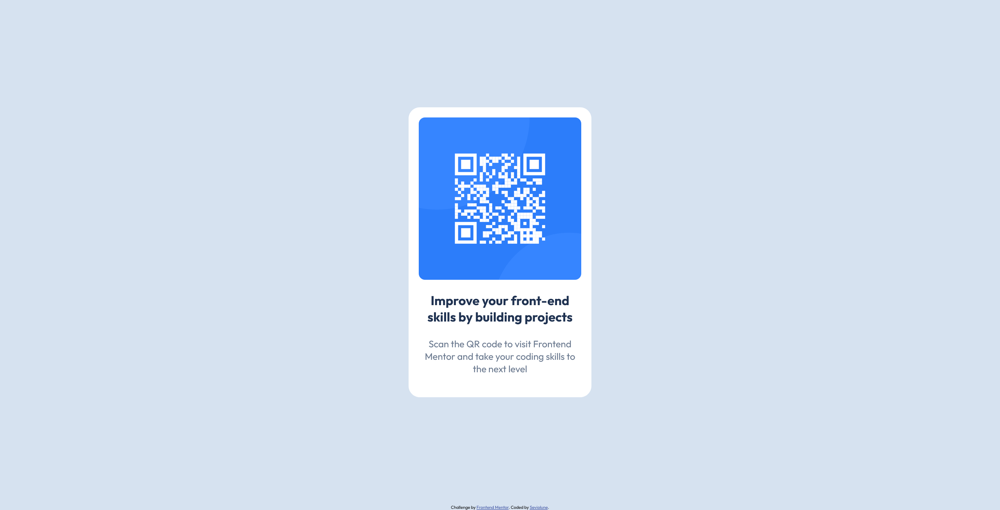

# Frontend Mentor - QR code component solution

This is a solution to the [QR code component challenge on Frontend Mentor](https://www.frontendmentor.io/challenges/qr-code-component-iux_sIO_H). Frontend Mentor challenges help you improve your coding skills by building realistic projects. 

## Table of contents

- [Overview](#overview)
  - [Screenshot](#screenshot)
  - [Links](#links)
- [My process](#my-process)
  - [Built with](#built-with)
  - [What I learned](#what-i-learned)
  - [Continued development](#continued-development)
  - [AI Collaboration](#ai-collaboration)
- [Author](#author)
- [Acknowledgments](#acknowledgments)

## Overview

### Screenshot



### Links

- Solution URL: [Add solution URL here](https://your-solution-url.com)
- Live Site URL: [Add live site URL here](https://your-live-site-url.com)

## My process

I did some HTML and CSS.
(I do have the local git commits but I have no idea what to write here. Sorry if you were interested.)

### Built with

- Semantic HTML5 markup
- Flexbox
- Mobile-first workflow

### What I learned

The footer element exists.
```html
<footer>It exists</footer>
```

Learned about viewport height and this trick.
```css
body {
  min-width: 100vh;
}
```

I used rem instead of px.

Learned to host live url.

### Continued development

Do more of these challenges I guess.

### AI Collaboration

Asked copilot for the first time to give me rem values. Ended up not using them because they looked wrong.
There's probably better uses of copilot out there.

## Author

- Github - [Seviolune](https://github.com/Seviolune)
- Frontend Mentor - [@Seviolune](https://www.frontendmentor.io/profile/Seviolune)

## Acknowledgments

You for bothering to read this.